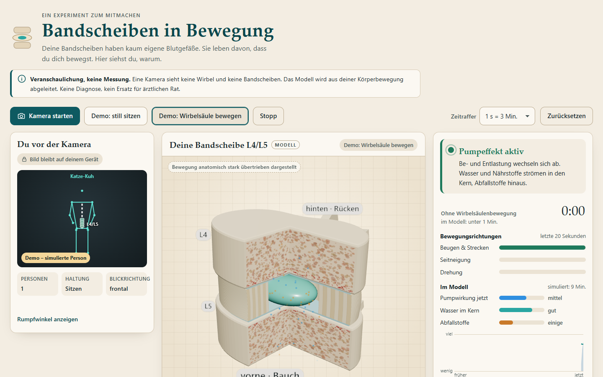
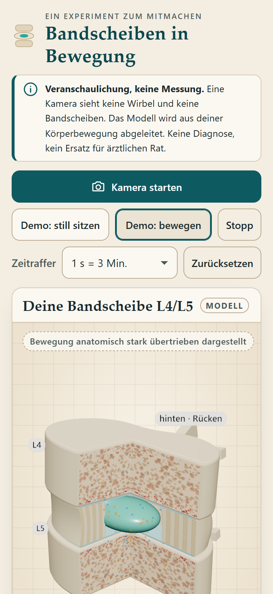
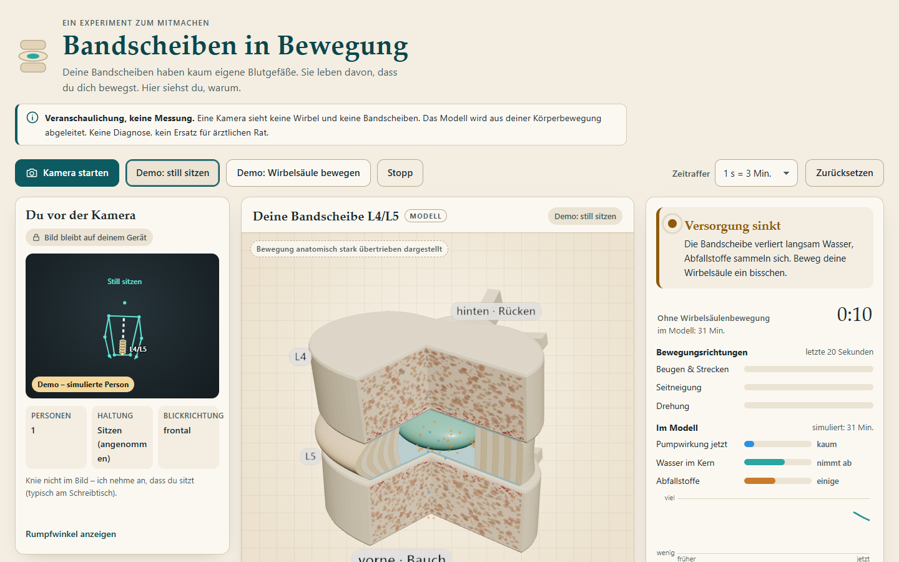

# Bandscheiben in Bewegung

Eine Webseite, die Menschen zum Bewegen bringt – vor allem ihre Wirbelsäule. Sie nutzt die Webcam, erkennt die Personen im Bild, zeichnet ihr Skelett ein und bewegt im Takt dazu ein 3D-Modell der Lendenbandscheibe L4/L5. So wird sichtbar, warum Bandscheiben Bewegung brauchen: Sie haben kaum eigene Blutgefäße und werden über Diffusion und einen „Pumpeffekt“ aus Be- und Entlastung versorgt.



 

> **Wichtig: Veranschaulichung, keine Messung.** Eine einzelne Kamera sieht keine Wirbel und keine Bandscheiben. Die Seite schätzt Körperpunkte, leitet daraus Rumpfbewegungen ab und füttert damit ein stark vereinfachtes Modell. Sie stellt **keine Diagnose** und ersetzt keine ärztliche oder physiotherapeutische Beratung.

## Inhalt

- [Funktionen](#funktionen)
- [Schnellstart](#schnellstart)
- [Wie es funktioniert](#wie-es-funktioniert)
- [Das Versorgungsmodell (Annahmen und Raten)](#das-versorgungsmodell-annahmen-und-raten)
- [Grenzen](#grenzen)
- [Datenschutz](#datenschutz)
- [Projektaufbau](#projektaufbau)
- [Tests](#tests)
- [Manueller Test mit echter Webcam](#manueller-test-mit-echter-webcam)
- [Veröffentlichen mit GitHub Pages](#veröffentlichen-mit-github-pages)
- [Lizenzen](#lizenzen)

## Funktionen

- **Kamera und Skelett:** Start per Button, Selfie-Ansicht (gespiegelt), Skelett für bis zu zwei Personen. Die zuerst erkannte bzw. größte Person steuert die Bandscheibe und bleibt auch dann ausgewählt, wenn MediaPipe die Reihenfolge wechselt. Auf der Linie Hüftmitte–Schultermitte sind die fünf Lendenbandscheiben schematisch eingezeichnet und nach Versorgungszustand eingefärbt.
- **Bewegungsanalyse aus einer Kamera:** Beugen/Strecken, Seitneigung und Drehung (Schultern gegen Becken) aus den 3D-Weltkoordinaten – frontal, schräg und seitlich zur Kamera. Bewegungsmaß aus der Schwankungsbreite in einem gleitenden Fenster mit Rauschgrenze. Sitzen/Stehen, wenn die Knie sichtbar sind; sonst wird Sitzen angenommen und das angezeigt. Ganzkörperbewegung (Aufstehen, Gehen) zählt mit.
- **3D-Bandscheibe L4/L5** (three.js) als Atlas-Schnittbild: Faserring mit Lamellen (wechselnde Faserrichtung an den Schnittflächen), Gallertkern, knorpelige Deckplatten, Wirbelkörper mit Spongiosa und Kapillaren, Wirbelbogen und Dornfortsatz als Orientierung („vorne · Bauch“ / „hinten · Rücken“). Die obere Platte kippt und dreht sich (übertrieben, im UI vermerkt), der Faserring staucht und buchtet aus, der Kern wandert, bei Drehung verdreht sich der Ring. Partikel zeigen Wasser/Nährstoffe hinein und Abfallstoffe hinaus. Bei Stillstand wird der Kern kleiner, matter und gelblicher, die Scheibe flacher, Abfallstoffe sammeln sich um den Kern. Ansicht per Ziehen, Pfeiltasten oder Buttons drehbar.
- **Versorgungsmodell im Zeitraffer** (Echtzeit, 1 s = 1/3/10 Min.), qualitativ angezeigt.
- **Coach:** Status in einfacher Sprache, der sich mit der Dauer ohne Wirbelsäulenbewegung steigert; Übungsvorschlag passend zur am wenigsten bewegten Richtung (Katze-Kuh, Seitneigung, Rumpfdrehung, Aufstehen); Fortschritt der drei Richtungen (letzte 20 s); Stillzeit; Verlaufsdiagramm. Optional Erinnerung im Tab-Titel und – nur nach Zustimmung – per Browser-Benachrichtigung.
- **Demo ohne Kamera:** „still sitzen“ und „Wirbelsäule bewegen“. Die Demo erzeugt künstliche Körperpunkte und läuft durch **dieselbe** Analysekette wie die Kamera. Vor dem Start läuft eine ruhige Vorschau.
- **Barrierefreiheit:** Tastaturbedienung mit sichtbarem Fokus, Skip-Link, `aria-live` für den Coach, Text-Alternativen, `prefers-reduced-motion` (weniger Partikel, ruhigere Animation), Dunkelmodus.
- **Robustheit:** verständliche Meldungen bei abgelehnter Freigabe, fehlender Kamera, belegter Kamera, fehlendem HTTPS; „keine Person“, „Hüfte/Schultern nicht sichtbar“; Kameraverlust und eingefrorenes Bild werden erkannt; im Hintergrund-Tab läuft die Analyse mit 1 Hz weiter; Fehler in einzelnen Bildern stoppen die Schleife nicht; ohne WebGL funktioniert alles außer der 3D-Ansicht.

## Schnellstart

Reine statische Dateien, kein Build. Die Kamera braucht einen sicheren Kontext: **HTTPS** oder **http://localhost**.

> **`index.html` per Doppelklick (file://) funktioniert nicht.** Chrome und andere Browser blockieren dann das Laden der JavaScript-Module („origin 'null' … blocked by CORS policy“) – es erscheint nur die statische Seite ohne Funktion. Ein lokaler Webserver ist nötig.

**Windows, ganz ohne Installation:** `start.cmd` doppelklicken. Das startet `serve.ps1` (ein kleiner PowerShell-Webserver, nur von diesem Rechner aus erreichbar) und öffnet <http://localhost:8090/> im Standardbrowser. Zum Beenden das Konsolenfenster schließen.

```bash
# Variante A: mit Node.js (ohne Abhängigkeiten)
node tests/serve.mjs 8080

# Variante B: mit Python
python -m http.server 8080
```

Dann <http://localhost:8080/> öffnen. Über die LAN-IP (z. B. vom Handy) funktioniert die Kamera nur mit HTTPS – dafür am einfachsten GitHub Pages nutzen.

## Wie es funktioniert

```
Webcam ──► MediaPipe Pose Landmarker (lite, 2 Personen, VIDEO-Modus, GPU→CPU-Fallback)
             │  33 Bildpunkte + 33 Weltpunkte (Meter, Ursprung Hüftmitte) je Person
             ▼
PersonTracker ─ Hauptperson wählen und verfolgen, One-Euro-Filter
             ▼
spine.js ─ Rumpfwinkel · Sitzen/Stehen · Bewegungsmaß · Ganzkörperbewegung
             ▼
supply.js ─ Versorgungsmodell (Zeitraffer)      coach.js ─ Status, Übung, Stillzeit
             ▼
disc3d.js (3D) · overlay.js (Skelett) · chart.js (Verlauf) · DOM
```

### Rumpfwinkel (`js/spine.js`)

- **Koordinaten:** Die Analyse rechnet immer auf den **ungespiegelten** Rohdaten; gespiegelt wird nur beim Zeichnen. „Links/rechts“ ist daher immer aus Sicht der Person (MediaPipe: Index 11 = linke Schulter). Intern: x = Bild-rechts, y = oben, z = zur Kamera.
- **Körperbezug unabhängig von der Blickrichtung:** Aus der Becken-Querachse (rechte → linke Hüfte, waagerecht gemacht) und der Lotrechten entsteht „vorne“ der Person: `vorne = links × oben`. Damit funktionieren die Winkel frontal, schräg und seitlich. Voraussetzung: Die Kamera steht ungefähr aufrecht.
- **Beugen/Strecken** = Neigung der Rumpfachse (Hüftmitte → Schultermitte) nach vorne/hinten gegen die Lotrechte. **+ = Vorbeugen**.
- **Seitneigung** = Neigung der Rumpfachse zur Seite. **+ = nach rechts**.
- **Drehung** = Winkel zwischen Schulter- und Beckenachse, beide in die Ebene senkrecht zur Rumpfachse projiziert. **+ = Schultern nach rechts gedreht**.
- **Tiefenachse:** Die MediaPipe-Dokumentation legt die Richtung der z-Achse für *Welt*koordinaten nicht ausdrücklich fest (nur für Bildkoordinaten: „kleiner = näher an der Kamera“). Die Seite nimmt dieselbe Konvention an und **prüft sie laufend anatomisch**: Die Nase liegt vor den Ohren. Zeigt die berechnete Vorwärtsrichtung über viele Bilder systematisch hinter das Gesicht, wird die Tiefenachse umgedreht (`DepthConventionCheck`). Das betrifft die Vorzeichen von Beugen und Drehung.
- **Sichtbarkeit:** Schultern müssen sicher erkannt sein (≥ 0,5), die Hüfte mindestens schwach (≥ 0,2; zwischen 0,2 und 0,5 erscheint ein Hinweis „ungenau“).

### Bewegungsmaß

- Fenster der letzten **6 s**; Spannweite je Richtung als 90.–10. Perzentil (robust gegen Ausreißer).
- **Rauschgrenze** je Richtung 3–8°, abhängig davon, wie stark die Bewegung in der Bildtiefe liegt (die eine Kamera nur schätzt). Darunter zählt nichts. Volle Wertung ab 28° (Beugen), 16° (Seitneigung), 22° (Drehung) Schwankungsbreite.
- Gesamtmaß = 0,7 · stärkste Richtung + 0,3 · Mittelwert. **Verharren in einer Haltung ergibt 0**, egal wie krumm.
- **Ganzkörperbewegung:** Verschiebung der Hüftmitte im Bild über ~0,5 s, normiert auf die Rumpflänge (gegen Zittern); ein erkannter Wechsel Sitzen ↔ Stehen zählt voll; Nachlauf ~3 s.
- **Sitzen/Stehen:** Winkel Oberschenkel–Lotrechte < 35° = Stehen, > 55° = Sitzen, dazwischen bleibt der letzte Zustand (Hysterese, 6 Bilder Bestätigung). Ohne sichtbare Knie wird Sitzen angenommen.

## Das Versorgungsmodell (Annahmen und Raten)

`js/supply.js` ist **bewusst einfach und qualitativ**. Es soll die biomechanische Grundidee erlebbar machen, nicht Physiologie simulieren. Die Zahlen sind Gestaltungsentscheidungen, **keine medizinischen Werte**; das UI zeigt nur Worte („Versorgung sinkt“), keine Prozente.

**Grundidee:**

1. Die erwachsene Bandscheibe ist im Inneren praktisch gefäßfrei. Kleine Moleküle wie Sauerstoff und Glukose gelangen per **Diffusion** aus den Kapillaren der Wirbelkörper über die knorpeligen **Deckplatten** in den Gallertkern; Stoffwechselprodukte (z. B. Laktat) nehmen den umgekehrten Weg (Urban et al. 2004; Urban & Roberts 2003).
2. Unter Last verliert die Bandscheibe Flüssigkeit, bei Entlastung nimmt sie wieder auf (Adams & Hutton 1983). Wechselnde Be- und Entlastung erzeugt einen konvektiven Flüssigkeitsaustausch – den „Schwamm-“ oder „Pumpeffekt“. Bewegung verbesserte im Tierversuch die Versorgung (Holm & Nachemson 1983). Für kleine Moleküle bleibt Diffusion der Haupttransportweg; Konvektion hilft vor allem größeren Molekülen und dem Wasseraustausch (Ferguson et al. 2004).
3. Langes, unbewegtes Sitzen bedeutet gleichbleibende Last und wenig Wechsel. Ob Sitzen an sich stärker belastet als Stehen, hängt von der Sitzhaltung ab: Ältere Druckmessungen fanden höhere Werte im Sitzen, neuere (Wilke et al. 1999) zeigen für entspanntes Sitzen ähnliche oder niedrigere Werte als im Stehen und höhere für vorgebeugtes Sitzen. Das Modell nimmt – wie in der Aufgabenstellung vorgesehen – für Sitzen eine etwas höhere Dauerlast an; der entscheidende Faktor im Modell ist aber die **fehlende Bewegung**.

**Zustandsgrößen** (0 … 1): Flüssigkeit im Kern *F*, Austausch durch Bewegung *E*, Abfallstoffe *W*, abgeleitete Versorgung *S*.

```
pump  = max(Wirbelsäulenbewegung, 0,7 · Ganzkörperbewegung)
E    → E_BASE + (1 − E_BASE) · pump            (folgt in Echtzeit, τ = 1,2 s)
dF/dt = K_IN · E · (1 − F) − K_OUT · Last · F · (1 − 0,7 · E)
dW/dt = W_PROD − K_CLEAR · E · W
S     = 0,5 · F + 0,3 · (1 − W) + 0,2 · E
```

| Größe | Wert | Bedeutung |
|---|---|---|
| `E_BASE` | 0,15 | Grund-Diffusion: Der Austausch stoppt nie ganz |
| `K_IN` | 0,039 / min | Wasseraufnahme bei Entlastung/Bewegung |
| `K_OUT` | 0,0121 / min | Wasserverlust unter Dauerlast |
| `W_PROD` | 0,0106 / min | Entstehung von Stoffwechselprodukten |
| `K_CLEAR` | 0,083 / min | Abtransport proportional zum Austausch |
| Last Sitzen / Stehen | 1,0 / 0,75 | qualitative Annahme (siehe oben) |

Daraus folgt (simulierte Zeit): Unbewegtes Sitzen senkt *F* mit einer Zeitkonstanten von etwa einer Stunde Richtung ~0,35, Abfallstoffe steigen; aktive Bewegung bringt *F* in ~20–25 Minuten Richtung ~0,9. Der **Zeitraffer** (Echtzeit, 1 s = 1/3/10 Min.) bestimmt, wie schnell das auf dem Bildschirm passiert; Stillzeit und simulierte Zeit werden angezeigt. Ohne verwertbare Daten (niemand im Bild) pausiert das Modell.

**Coach-Stufen** nach simulierter Zeit ohne Wirbelsäulenbewegung: < 5 Min. „Kurze Ruhephase“, < 20 Min. „Austausch gedrosselt“, < 45 Min. „Versorgung sinkt“, danach „Bandscheibe wird unterversorgt“ – oder früher, wenn der Versorgungsindex fällt.

**Literatur zur Grundidee** (zum Weiterlesen; die Raten oben sind nicht daraus abgeleitet):

- Urban JPG, Smith S, Fairbank JCT. *Nutrition of the intervertebral disc.* Spine 2004;29(23):2700–2709.
- Urban JPG, Roberts S. *Degeneration of the intervertebral disc.* Arthritis Res Ther 2003;5(3):120–130.
- Holm S, Nachemson A. *Variations in the nutrition of the canine intervertebral disc induced by motion.* Spine 1983;8(8):866–874.
- Adams MA, Hutton WC. *The effect of posture on the fluid content of lumbar intervertebral discs.* Spine 1983;8(6):665–671.
- Ferguson SJ, Ito K, Nolte LP. *Fluid flow and convective transport of solutes within the intervertebral disc.* J Biomech 2004;37(2):213–221.
- Wilke HJ, Neef P, Caimi M, Hoogland T, Claes LE. *New in vivo measurements of pressures in the intervertebral disc in daily life.* Spine 1999;24(8):755–762.

## Grenzen

- **Keine Messung, keine Diagnose.** Bandscheiben werden nicht gesehen, sondern modelliert. Segmentbewegungen in L4/L5 sind in Wirklichkeit nur wenige Grad; die 3D-Ansicht übertreibt sie stark (Beugen ×0,4, Seitneigung ×0,6, Drehung ×0,4 der Rumpfwinkel, begrenzt auf 11–13°).
- Die Rumpfwinkel sind **Schätzungen** aus einer Kamera. Bewegungen in der Bildtiefe (Vorbeugen bei frontaler Sicht, Seitneigung/Drehung bei seitlicher Sicht) sind unsicherer; deshalb ist die Rauschgrenze dort höher. Beugen in der Hüfte und in der Lendenwirbelsäule lassen sich nicht trennen.
- Von hinten gefilmt kann MediaPipe links und rechts vertauschen; die Werte sind dann unzuverlässig.
- Hinter dem Schreibtisch ist die Hüfte oft verdeckt. MediaPipe schätzt sie trotzdem, die Seite weist dann auf ungenaue Werte hin.
- Eine wackelnde Handykamera kann als Ganzkörperbewegung missverstanden werden.
- Die Kamera sollte ungefähr aufrecht stehen (die Lotrechte wird aus „Bild-oben“ abgeleitet).
- Im Hintergrund-Tab drosseln Browser Zeitgeber teils stark; Analyse und Erinnerung können dann seltener laufen.
- Browser-Benachrichtigungen sind auf iOS nur für installierte Web-Apps verfügbar; der Hinweis im Tab-Titel funktioniert überall.

## Datenschutz

- Das Kamerabild wird **ausschließlich im Browser** ausgewertet. Es wird nichts hochgeladen, gespeichert oder aufgezeichnet.
- Bibliothek, WASM-Dateien und Modell liegen **im Repository**; zur Laufzeit wird kein fremder Server kontaktiert. Eine **Content-Security-Policy** in `index.html` (`default-src 'self'; connect-src 'self'` …) verbietet dem Browser zusätzlich jede Verbindung zu fremden Servern. Die automatischen Tests prüfen, dass keine Anfrage den eigenen Ursprung verlässt.
- **MediaPipe-Version bewusst gewählt:** Die aktuellen Versionen `@mediapipe/tasks-vision` 1.0.0–1.1.1 enthalten einen fest eingebauten Logger, der beim Erstellen eines Tasks startet und minütlich Nutzungsmetriken an `https://odml.pa.googleapis.com/v1/log` sendet (laut Paket-README keine Bilddaten). Die Seite nutzt deshalb **0.10.35**, das diesen Code nicht enthält. Bei einem Update bitte erneut prüfen (z. B. `grep -c "v1/log" vision_bundle.mjs`). Die CSP würde solche Anfragen ohnehin blockieren.
- Keine Konten, keine Cookies, kein Tracking, keine Web-Fonts von Drittanbietern. Im `localStorage` stehen nur die Zeitraffer-Einstellung und ob die Erinnerung an ist.

## Projektaufbau

```
index.html              Seite, CSP, Texte
start.cmd, serve.ps1    lokaler Start unter Windows ohne Node/Python (http://localhost:8090)
css/style.css           Gestaltung (Atlas-Optik, responsiv, Dunkelmodus, reduzierte Bewegung)
js/main.js              Verdrahtung: Modi, Schleife, Hintergrund-Wächter, UI, Erinnerungen
js/pose.js              Kamera, MediaPipe laden (GPU→CPU), Fehlermeldungen, Personen-Tracking
js/spine.js             One-Euro-Filter, Rumpfwinkel, Tiefenachsen-Prüfung, Sitzen/Stehen, Bewegungsmaß
js/supply.js            Versorgungsmodell und Zeitraffer-Stufen
js/coach.js             Status-Stufen, Übungen, Zeitformatierung
js/disc3d.js            three.js-Szene: Faserring (CPU-Deformation), Kern, Wirbel, Partikel
js/overlay.js           Skelett, Wirbelsäulenlinie, Lendenbandscheiben-Markierungen
js/chart.js             Verlaufsdiagramm (Canvas)
js/demo.js              Vorschau und Demo-Modi
js/synth.js             künstliche MediaPipe-Posen (Demo und Tests)
vendor/three/           three.js 0.186.1 (MIT)
vendor/mediapipe/       @mediapipe/tasks-vision 0.10.35 inkl. WASM (Apache-2.0)
models/                 pose_landmarker_lite.task (+ Herkunft, Prüfsumme)
tests/unit.test.mjs     Unit-Tests (node --test, keine Abhängigkeiten)
tests/e2e.mjs           Playwright-Tests mit Fake-Webcam
tests/serve.mjs         kleiner statischer Webserver
docs/                   Screenshots für diese README
.nojekyll               GitHub Pages: Dateien unverändert ausliefern
```

Zum Aktualisieren der Bibliotheken: die Dateien aus den npm-Paketen (Pfade siehe `vendor/README.md`) austauschen, Version im Kommentar/README anpassen, Tests laufen lassen. three.js-Importe sind relativ (`../vendor/three/three.module.js`, das wiederum `./three.core.js` lädt) – eine Importmap ist nicht nötig.

## Tests

Benötigt Node.js ≥ 20. Für die End-to-End-Tests wird nur `playwright-core` installiert; als Browser dient das installierte Google Chrome (alternativ `CHROME_PATH=/pfad/zu/chromium` setzen).

```bash
npm test          # Unit-Tests
npm install       # einmalig: playwright-core
npm run e2e       # Browser-Tests, Screenshots in tests/output/
```

**Unit-Tests** (künstliche Landmarken aus `js/synth.js`): Vorbeugen/Strecken, Seitneigung, Drehung inkl. Vorzeichen bei sieben Blickrichtungen (frontal, schräg, seitlich, von hinten), Drehung im Vorbeugen, Übersprechen zwischen Richtungen, Plausibilität der Rohdaten, fehlende Schultern/Hüfte, Tiefenachsen-Prüfung, Sitzen/Stehen mit Hysterese und Annahme ohne Knie, Rauschen und starres Verharren ergeben kein Bewegungsmaß, Übungsbewegungen werden erkannt, Ganzkörperbewegung, One-Euro-Filter, Versorgungsmodell (Richtung, Stehen vs. Sitzen, Zeitraffer, Stabilität bei Extremwerten).

**End-to-End-Tests** (Chrome headless, `--use-fake-device-for-media-stream`, `--use-fake-ui-for-media-stream`): keine Konsolen-, Skript- oder Netzwerkfehler, keine Anfragen an fremde Server, WebGL aktiv, MediaPipe wird erst beim Kamerastart geladen, WASM und Modell laden lokal, Erkennung läuft (GPU, sonst CPU), „Keine Person erkannt“ beim Testbild, Kameraverlust, verweigerte Freigabe, fehlendes HTTPS, beide Demo-Modi (Modellrichtung, Coach-Eskalation, alle drei Richtungen, Aufstehen), Tastaturbedienung, Hintergrund-Tab (1-Hz-Analyse, Titel-Erinnerung), 375 px ohne horizontales Scrollen, Dunkelmodus und reduzierte Bewegung. Screenshots: Desktop und 375 px.

Optional: Ein Video einer Person als `tests/fixtures/person.y4m` (oder `.mjpeg`) ablegen; dann wird es per `--use-file-for-fake-video-capture` als Kamera genutzt und geprüft, ob eine Person erkannt wird. Umwandeln z. B. mit `ffmpeg -i person.mp4 -pix_fmt yuv420p -vf scale=640:480 person.y4m`.

## Manueller Test mit echter Webcam

Was automatisiert **nicht** prüfbar ist (Erkennung echter Personen, Qualität der Winkel, Geräte und Browser):

1. **Start:** „Kamera starten“ → Browser fragt nach der Kamera → Bild erscheint gespiegelt, Skelett liegt auf dem Körper.
2. **Vorzeichen:** „Rumpfwinkel anzeigen“ aufklappen. Vorbeugen → Beugen zeigt **„+ … vor“**; zurücklehnen → „− … zurück“; nach rechts neigen → Seitneigung **„+ … rechts“**; Oberkörper nach rechts drehen → Drehung **„+ … rechts“**. (Rechts = deine rechte Seite, im Spiegelbild also auf der rechten Bildschirmseite.)
3. **Seitlich sitzen:** Stuhl um 90° drehen, Punkt 2 wiederholen. Blickrichtung sollte „seitlich“ zeigen, Vorzeichen gleich bleiben.
4. **Still sitzen:** 30 s ruhig sitzen (Zeitraffer 1 s = 3 Min.) → Bewegungsbalken bleiben leer, Status steigt über „Austausch gedrosselt“ zu „Versorgung sinkt“, Kern wird matter/kleiner, ockerfarbene Partikel sammeln sich.
5. **Bewegen:** Katze-Kuh, Seitneigung, Drehung → „Pumpeffekt aktiv“, Balken füllen sich, Versorgung erholt sich; der Übungsvorschlag wechselt zur am wenigsten bewegten Richtung.
6. **Sitzen/Stehen:** Mit Knien im Bild aufstehen → Haltung „Stehen“; Knie verdecken → „Sitzen (angenommen)“ mit Hinweis.
7. **Zwei Personen:** Zweite Person kommt ins Bild → zweites (graues) Skelett; die erste Person steuert weiter.
8. **Verdeckung:** Hüfte hinter dem Tisch → Hinweis „ungenau“; aus dem Bild gehen → „Keine Person erkannt“, Simulation pausiert.
9. **Hintergrund:** Erinnerung einschalten, Tab wechseln und still sitzen (Zeitraffer 1 s = 10 Min.) → Tab-Titel zeigt „⏰ Zeit für Bewegung“; bei erlaubter Benachrichtigung kommt eine Meldung.
10. **Kamera abziehen** (USB) während des Betriebs → Meldung „Verbindung abgebrochen“, „Erneut versuchen“ funktioniert.
11. **Smartphone** (über die GitHub-Pages-URL): Frontkamera startet, Layout passt, 3D-Ansicht per Wischen drehbar, Seite bleibt flüssig.
12. **Browser:** Chrome, Edge, Firefox, Safari (macOS und iOS) je einmal Punkt 1, 2 und 5.

## Veröffentlichen mit GitHub Pages

Es gibt keinen Build-Schritt; GitHub Pages liefert die Dateien direkt aus. `.nojekyll` sorgt dafür, dass nichts umgebaut wird.

1. Repository auf GitHub anlegen und den Code pushen (Befehle unten).
2. Im Repository **Settings → Pages** öffnen.
3. Unter **Build and deployment → Source** „**Deploy from a branch**“ wählen.
4. Bei **Branch** „`main`“ und Ordner „`/ (root)`“ wählen, **Save**.
5. Nach ein bis zwei Minuten erscheint oben die Adresse, z. B. `https://<benutzername>.github.io/bandscheiben-in-bewegung/`. **Enforce HTTPS** sollte aktiv sein (Standard).

```bash
cd pfad/zum/projekt
git init -b main
git add .
git commit -m "Bandscheiben in Bewegung: erste Version"
git remote add origin https://github.com/<benutzername>/bandscheiben-in-bewegung.git
git push -u origin main
```

Mit der GitHub-CLI geht Anlegen, Pushen und Aktivieren von Pages auch in einem Rutsch:

```bash
gh repo create bandscheiben-in-bewegung --public --source=. --remote=origin --push
gh api -X POST repos/<benutzername>/bandscheiben-in-bewegung/pages -f "source[branch]=main" -f "source[path]=/"
```

Der Workflow `.github/workflows/tests.yml` führt bei jedem Push die Unit-Tests aus; für Pages selbst ist keine Action nötig.

## Lizenzen

- **Eigener Code:** MIT (siehe `LICENSE`).
- **three.js** 0.186.1 – MIT License, © three.js authors (`vendor/three/LICENSE`).
- **MediaPipe Tasks Vision** (`@mediapipe/tasks-vision`) 0.10.35 inkl. WebAssembly – Apache License 2.0, © Google LLC (`vendor/mediapipe/LICENSE`).
- **Pose-Landmarker-Modell** `pose_landmarker_lite.task` (BlazePose GHUM 3D) – herausgegeben von Google/MediaPipe. Die Lizenzbedingungen stehen in der [Model Card](https://storage.googleapis.com/mediapipe-assets/Model%20Card%20BlazePose%20GHUM%203D.pdf); MediaPipe-Modelle werden nach meinem Kenntnisstand unter Apache 2.0 bereitgestellt – **bitte vor der Veröffentlichung in der Model Card bestätigen**. Herkunft und Prüfsumme: `models/README.md`.
- **playwright-core** (nur Entwicklung/Test, nicht ausgeliefert) – Apache License 2.0.

Alle Texte, die Gestaltung und die 3D-Geometrie (prozedural erzeugt) sind Teil dieses Projekts; es werden keine fremden Bilder, Fonts oder 3D-Modelle verwendet.
